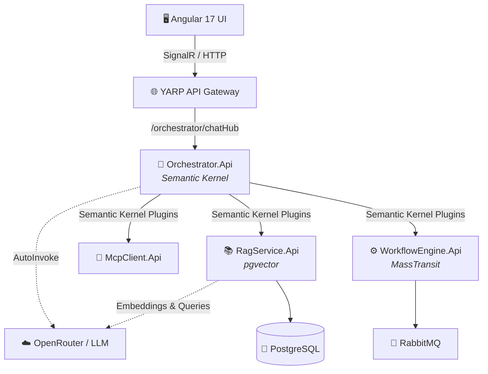

# 🏥 Healthcare AI Copilot & Microservices Ecosystem

Welcome to the **Healthcare AI** project! This is a state-of-the-art, event-driven microservices architecture designed to empower medical professionals with an autonomous AI Copilot. The system integrates advanced LLM routing, Retrieval-Augmented Generation (RAG) for medical literature, direct hospital system integration (MCP), and automated workflow orchestration.

---

## 🏗️ Architecture & Flowchart

The system consists of a glassmorphic Angular frontend that communicates in real-time with an intelligent backend via an API Gateway. The central "brain" is the **Orchestrator API**, which uses Microsoft Semantic Kernel to autonomously route user intents to specialized microservices.



---

## 🛠️ Technologies Used

### Frontend
- **Angular 17** (Standalone Components)
- **RxJS & SignalR** (Real-time WebSockets)
- **CSS3** (Custom Glassmorphism, CSS Variables, Flexbox/Grid)
- **Nginx** (Lightweight containerized web server)

### Backend (Microservices)
- **.NET 8 Web API** (Minimal APIs)
- **YARP** (Reverse Proxy API Gateway)
- **Microsoft Semantic Kernel** (Autonomous AI Function Calling)
- **MassTransit** (Saga State Machines for Workflow automation)
- **SignalR** (Real-time bidirectional streaming)
- **Serilog** (Structured logging)

### Infrastructure & Data
- **Docker & Docker Compose** (Container orchestration)
- **PostgreSQL + pgvector** (Relational & Vector database for RAG)
- **RabbitMQ** (Message broker for MassTransit Sagas)
- **OpenRouter** (Unified LLM access to `google/gemma-2-9b-it:free`)

---

## 🚀 How to Execute the App

### Prerequisites
- Docker & Docker Compose installed
- Node.js (v18+) and Angular CLI (optional, for local frontend dev)
- An OpenRouter API Key (Free tier works!)

### 1. Configure the API Key
Open the `docker-compose.yml` file and locate the `orchestrator-api` service. Replace the placeholder with your actual OpenRouter API key:
```yaml
  orchestrator-api:
    environment:
      - ASPNETCORE_ENVIRONMENT=Development
      - OPENROUTER_API_KEY=sk-or-v1-YOUR-ACTUAL-KEY-HERE
```

### 2. Build and Spin Up the Containers
From the root directory (`/health-ai`), run the following command to build the entire ecosystem and start the containers in the background:
```bash
docker-compose up --build -d
```

### 3. Verify Services are Running
Ensure all containers booted successfully by checking:
```bash
docker-compose ps
```
You should see `postgres`, `rabbitmq`, `apigateway`, `orchestrator-api`, `ragservice-api`, `mcpclient-api`, `workflowengine-api`, and `frontend` all marked as **Up**.

### 4. Access the Application
- **Frontend UI**: Open [http://localhost:4200](http://localhost:4200) in your web browser.
- **API Gateway**: Running on [http://localhost:5000](http://localhost:5000).

### 5. Test the AI Copilot!
Navigate to the **AI Copilot** tab in the UI. 
- **Test MCP**: Ask *"What are John Doe's latest lab results?"*
- **Test Workflows**: Ask *"Please schedule a cardiology appointment for John Doe next Monday."*
- **Test RAG**: Ask *"What are the latest clinical guidelines for treating hypertension?"*

The Semantic Kernel will automatically deduce your intent, invoke the correct backend C# plugin, fetch the data, and stream the formatted response back to your screen with a color-coded status badge!

---

## 🛑 Shutting Down
To tear down the ecosystem and remove the containers, run:
```bash
docker-compose down
```
*(To wipe the PostgreSQL and RabbitMQ data volumes completely, append `-v`)*
