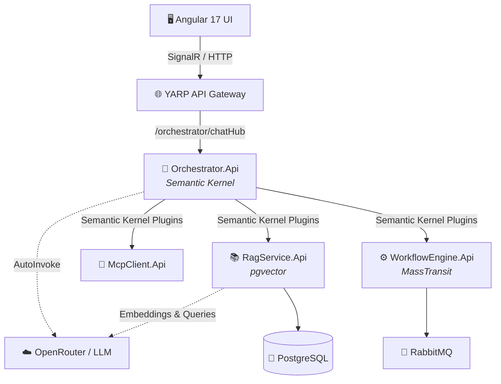
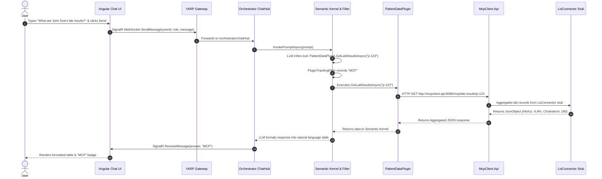
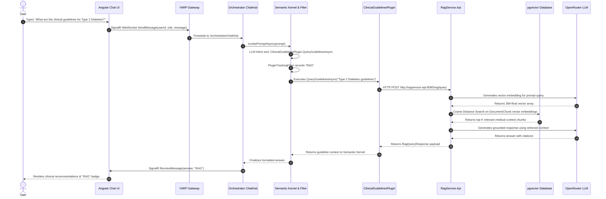
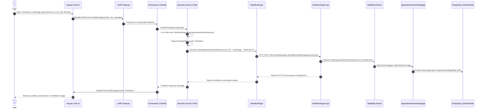

# 🏥 Healthcare AI Copilot & Microservices Ecosystem

Welcome to the **Healthcare AI** project! This is a state-of-the-art, event-driven microservices architecture designed to empower medical professionals with an autonomous AI Copilot. The system integrates advanced LLM routing, Retrieval-Augmented Generation (RAG) for medical literature, direct hospital system integration (MCP), and automated workflow orchestration.

---

## 🏗️ Architecture & Flowchart

The system consists of a glassmorphic Angular frontend that communicates in real-time with an intelligent backend via an API Gateway. The central "brain" is the **Orchestrator API**, which uses Microsoft Semantic Kernel to autonomously route user intents to specialized microservices.



---

## 🧩 System Class Diagram & Code Execution Flow

### 1. Class Diagram & Component Structure
The class diagram below details the underlying C# and Angular classes, interfaces, plugins, EF Core contexts, and how they connect across microservices:

```mermaid
classDiagram
    namespace Frontend {
        class ChatComponent {
            +string userId
            +string role
            +sendMessage(string text)
            +ngOnInit()
        }
        class ChatService {
            +startConnection()
            +sendMessage(string userId, string role, string message)
            +onReceiveMessage(callback)
        }
    }

    namespace Orchestrator_Api {
        class ChatHub {
            +SendMessage(string userId, string role, string message)
        }
        class PluginTrackingFilter {
            +OnFunctionInvocationAsync(context, next)
        }
        class PluginTracker {
            +string LastInvokedPlugin
        }
        class PatientDataPlugin {
            +GetPatientRecordAsync(string patientId) string
            +GetLabResultsAsync(string patientId) string
        }
        class ClinicalGuidelinesPlugin {
            +QueryGuidelinesAsync(string query) string
        }
        class WorkflowPlugin {
            +StartAppointmentWorkflowAsync(string patientId, string providerId, DateTime date) string
            +StartPrescriptionRefillAsync(string patientId, string medicationId) string
        }
    }

    namespace RagService_Api {
        class RagQueryEndpoint {
            +MapPost_RagQuery(request)
        }
        class RagSearchService {
            +RankDocumentsAsync(query, documents, topK)
        }
        class OpenRouterEmbeddingService {
            +GenerateEmbeddingAsync(string text)
        }
        class OpenRouterCompletionService {
            +GenerateAnswerAsync(string query, context)
        }
        class RagDbContext {
            +DbSet_DocumentChunk Documents
        }
        class DocumentChunk {
            +Guid Id
            +string Content
            +Vector Embedding
        }
    }

    namespace McpClient_Api {
        class McpEndpoints {
            +GetPatientRecordsEndpoint(string patientId)
            +GetLabResultsEndpoint(string patientId)
        }
        class HospitalSystemConnectorFactory {
            +GetConnector(string systemName) IHospitalSystemConnector
        }
        class IHospitalSystemConnector {
            <<interface>>
            +GetPatientRecordAsync(string patientId)
            +GetLabResultsAsync(string patientId)
        }
        class EmrConnector {
            +GetPatientRecordAsync(string patientId)
        }
        class LisConnector {
            +GetLabResultsAsync(string patientId)
        }
    }

    namespace WorkflowEngine_Api {
        class WorkflowEndpoints {
            +StartAppointmentEndpoint(request)
        }
        class AppointmentSchedulingSaga {
            +DefineState()
        }
        class AppointmentSagaState {
            +Guid CorrelationId
            +string CurrentState
            +string PatientId
        }
        class WorkflowDbContext {
            +DbSet_AppointmentSagaState AppointmentSagas
        }
    }

    ChatComponent --> ChatService : uses
    ChatService --> ChatHub : SignalR WebSockets
    ChatHub --> PluginTracker : resets tracker
    ChatHub ..> PluginTrackingFilter : intercepts invocation
    PluginTrackingFilter --> PluginTracker : records plugin

    ChatHub --> PatientDataPlugin : Semantic Kernel AutoInvoke
    ChatHub --> ClinicalGuidelinesPlugin : Semantic Kernel AutoInvoke
    ChatHub --> WorkflowPlugin : Semantic Kernel AutoInvoke

    PatientDataPlugin --> McpEndpoints : HTTP GET /mcp
    McpEndpoints --> HospitalSystemConnectorFactory : resolves connector
    HospitalSystemConnectorFactory --> IHospitalSystemConnector : returns stub
    IHospitalSystemConnector <|.. EmrConnector : implements
    IHospitalSystemConnector <|.. LisConnector : implements

    ClinicalGuidelinesPlugin --> RagQueryEndpoint : HTTP POST /rag/query
    RagQueryEndpoint --> RagSearchService : ranks docs
    RagSearchService --> OpenRouterEmbeddingService : generates embeddings
    RagQueryEndpoint --> RagDbContext : fetches all docs
    RagQueryEndpoint --> OpenRouterCompletionService : generates answer
    RagDbContext --> DocumentChunk : contains pgvector

    WorkflowPlugin --> WorkflowEndpoints : HTTP POST /workflows
    WorkflowEndpoints --> AppointmentSchedulingSaga : MassTransit Event
    AppointmentSchedulingSaga --> WorkflowDbContext : persists saga state
```



---

### 2. Contextual Execution Flows (By Prompt Scenario)

Depending on the specific prompt entered by the user, Semantic Kernel dynamically deduces the intent and routes the execution flow through different microservice pathways:

#### 🧪 Scenario A: Patient Records & Hospital Integration (MCP)
**User Prompt:** *"What are John Doe's lab results?"*



---

#### 📚 Scenario B: Medical Literature & Guidelines Search (RAG)
**User Prompt:** *"What are the clinical guidelines for managing Type 2 Diabetes?"*



---

#### ⚙️ Scenario C: Workflow Automation & Appointment Scheduling (MassTransit Sagas)
**User Prompt:** *"Please schedule a cardiology appointment for patient p-123 next Monday."*



---

## 🛠️ Technologies Used

### Frontend
- **Angular 17** (Standalone Components)
- **RxJS & SignalR** (Real-time WebSockets)
- **CSS3** (Custom Glassmorphism, CSS Variables, Flexbox/Grid)
- **Nginx** (Lightweight containerized web server)

### Backend (Microservices)
- **.NET 8 Web API** (Minimal APIs)
- **YARP** (Reverse Proxy API Gateway)
- **Microsoft Semantic Kernel** (Autonomous AI Function Calling)
- **MassTransit** (Saga State Machines for Workflow automation)
- **SignalR** (Real-time bidirectional streaming)
- **Serilog** (Structured logging)

### Infrastructure & Data
- **Docker & Docker Compose** (Container orchestration)
- **PostgreSQL + pgvector** (Relational & Vector database for RAG & Workflows)
- **RabbitMQ** (Message broker for MassTransit Sagas)
- **OpenRouter** (Unified LLM access with model `nvidia/nemotron-3.5-lightning:free`)

---

## 🔐 Environment & Secret Configuration

To prevent sensitive credentials and API keys from leaking to Git, secrets are stored in a local `.env` file (which is git-ignored) and dynamically injected into Docker containers at runtime. 

Non-sensitive configuration defaults (such as model choices and endpoints) are maintained in `appsettings.json` files for each microservice:
- **Orchestrator**: Configured in [src/Orchestrator.Api/appsettings.json](file:///d:/Code/health-ai/src/Orchestrator.Api/appsettings.json) (`CompletionModel`, `BaseUrl`).
- **RAG Service**: Configured in [src/RagService.Api/appsettings.json](file:///d:/Code/health-ai/src/RagService.Api/appsettings.json) (`EmbeddingModel`, `CompletionModel`).
- **Workflow Engine**: Configured in [src/WorkflowEngine.Api/appsettings.json](file:///d:/Code/health-ai/src/WorkflowEngine.Api/appsettings.json).

---

## 🚀 How to Execute the App

### Prerequisites
- Docker & Docker Compose installed
- An OpenRouter API Key (Free tier works!)

### 1. Create your Environment File (`.env`)
Create a `.env` file in the project root directory (`/health-ai`) with your OpenRouter key and database credentials:

```env
OPENROUTER_API_KEY=sk-or-v1-YOUR-ACTUAL-KEY-HERE
POSTGRES_USER=healthai
POSTGRES_PASSWORD=password
POSTGRES_DB=healthai_db
```

> ⚠️ **Note**: Never commit `.env` to source control. It is already included in `.gitignore`.

### 2. Build and Spin Up the Containers
From the root directory (`/health-ai`), run the following command to build the entire ecosystem and start the containers in the background:
```bash
docker-compose up --build -d
```

### 3. Verify Services are Running
Ensure all containers booted successfully by checking:
```bash
docker-compose ps
```
You should see `postgres`, `rabbitmq`, `apigateway`, `orchestrator-api`, `ragservice-api`, `mcpclient-api`, `workflowengine-api`, and `frontend` all marked as **Up**.

### 4. Access the Application
- **Frontend UI**: Open [http://localhost:4200](http://localhost:4200) in your web browser.
- **API Gateway**: Running on [http://localhost:5000](http://localhost:5000).

### 5. Test the AI Copilot!
Navigate to the **AI Copilot** tab in the UI. 
- **Test MCP**: Ask *"What are John Doe's latest lab results?"*
- **Test Workflows**: Ask *"Please schedule a cardiology appointment for John Doe next Monday."*
- **Test RAG**: Ask *"What are the latest clinical guidelines for treating hypertension?"*

The Semantic Kernel will automatically deduce your intent, invoke the correct backend C# plugin, fetch the data, and stream the formatted response back to your screen with a color-coded status badge!

---

## 🗄️ Database Inspection (PostgreSQL / DBeaver)

### Connect via DBeaver / GUI Client:
- **Host**: `localhost` (or `127.0.0.1`)
- **Port**: `5432`
- **Database**: `healthai_db`
- **Username**: `healthai`
- **Password**: `password`

### Query directly via Docker CLI:
```bash
# Interactive psql shell
docker exec -it postgres psql -U healthai -d healthai_db

# Query RAG document chunks
docker exec -it postgres psql -U healthai -d healthai_db -c "SELECT \"Id\", \"Content\" FROM \"Documents\";"

# Query Appointment Sagas
docker exec -it postgres psql -U healthai -d healthai_db -c "SELECT * FROM \"AppointmentSagaState\";"
```

---

## 🛑 Shutting Down
To tear down the ecosystem and remove the containers, run:
```bash
docker-compose down
```
*(To wipe the PostgreSQL and RabbitMQ data volumes completely, append `-v`)*
