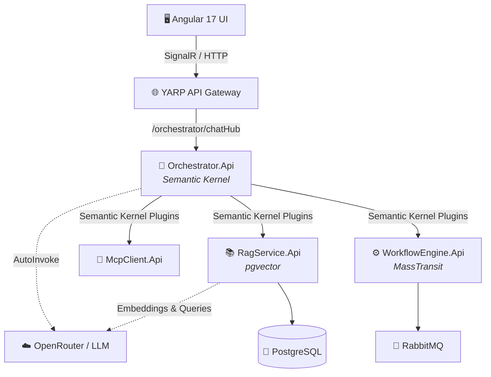
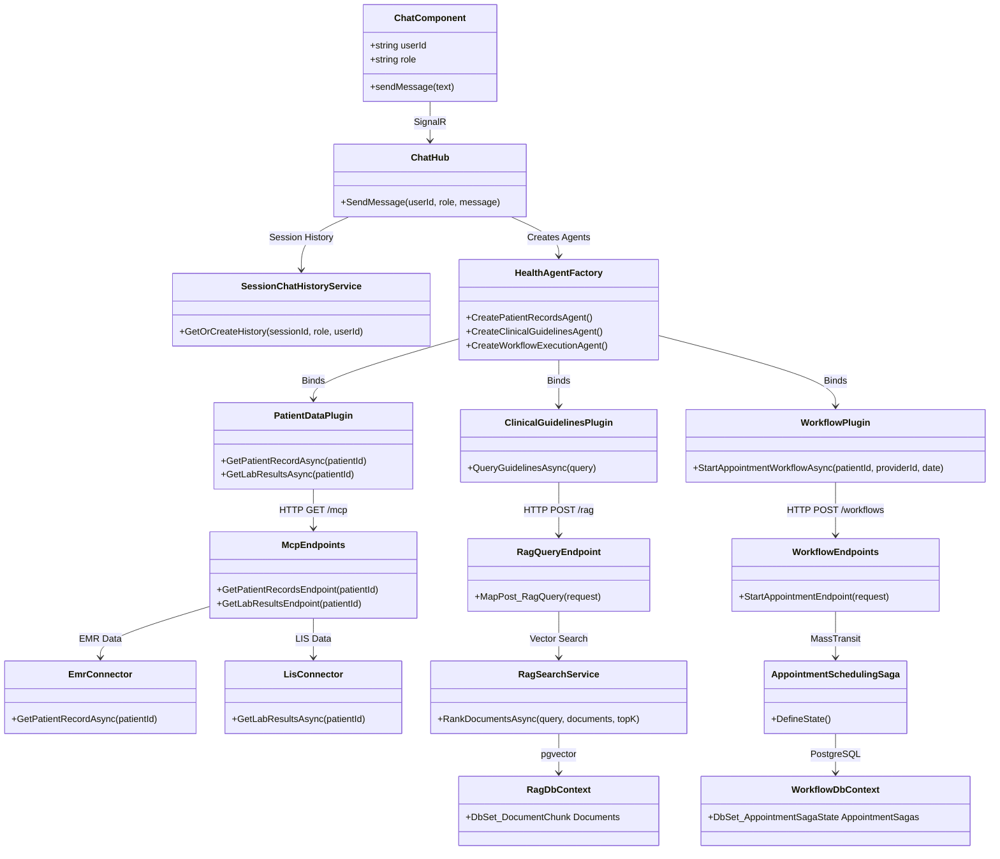
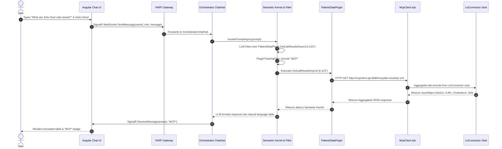
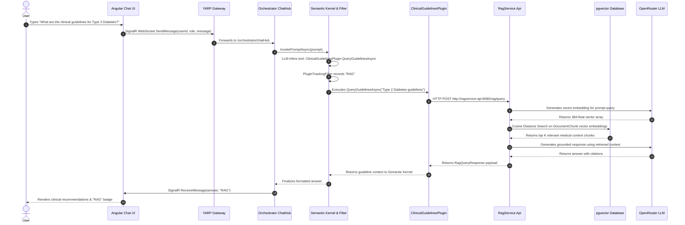
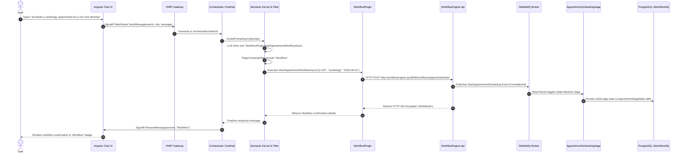

# 🏥 Healthcare AI Copilot & Microservices Ecosystem

Welcome to the **Healthcare AI** project! This is a state-of-the-art, event-driven microservices architecture designed to empower medical professionals with an autonomous AI Copilot. The system integrates advanced LLM routing, Retrieval-Augmented Generation (RAG) for medical literature, direct hospital system integration (MCP), and automated workflow orchestration.

---

## 🏗️ Architecture & Flowchart

The system consists of a glassmorphic Angular frontend that communicates in real-time with an intelligent backend via an API Gateway. The central "brain" is the **Orchestrator API**, which uses Microsoft Semantic Kernel to autonomously route user intents to specialized microservices.



---

## 🧩 System Class Diagram & Code Execution Flow

### 1. Class Diagram & Component Structure
The class diagram below details the underlying C# and Angular classes, interfaces, plugins, EF Core contexts, and how they connect across microservices:



---

### 2. Contextual Execution Flows (By Prompt Scenario)

Depending on the specific prompt entered by the user, Semantic Kernel dynamically deduces the intent and routes the execution flow through different microservice pathways:

#### 🧪 Scenario A: Patient Records & Hospital Integration (MCP)
**User Prompt:** *"What are John Doe's lab results?"*



---

#### 📚 Scenario B: Medical Literature & Guidelines Search (RAG)
**User Prompt:** *"What are the clinical guidelines for managing Type 2 Diabetes?"*



---

#### ⚙️ Scenario C: Workflow Automation & Appointment Scheduling (MassTransit Sagas)
**User Prompt:** *"Please schedule a cardiology appointment for patient p-123 next Monday."*



---

## 🛠️ Technologies Used

### Frontend
- **Angular 17** (Standalone Components)
- **RxJS & SignalR** (Real-time WebSockets)
- **CSS3** (Custom Glassmorphism, CSS Variables, Flexbox/Grid)
- **Nginx** (Lightweight containerized web server)

### Backend (Microservices)
- **.NET 8 Web API** (Minimal APIs)
- **YARP** (Reverse Proxy API Gateway)
- **Microsoft Semantic Kernel** (Autonomous AI Function Calling)
- **MassTransit** (Saga State Machines for Workflow automation)
- **SignalR** (Real-time bidirectional streaming)
- **Serilog** (Structured logging)

### Infrastructure & Data
- **Docker & Docker Compose** (Container orchestration)
- **PostgreSQL + pgvector** (Relational & Vector database for RAG & Workflows)
- **RabbitMQ** (Message broker for MassTransit Sagas)
- **OpenRouter** (Unified LLM access with model `nvidia/nemotron-3.5-lightning:free`)

---

## 🔐 Environment & Secret Configuration

To prevent sensitive credentials and API keys from leaking to Git, secrets are stored in a local `.env` file (which is git-ignored) and dynamically injected into Docker containers at runtime. 

Non-sensitive configuration defaults (such as model choices and endpoints) are maintained in `appsettings.json` files for each microservice:
- **Orchestrator**: Configured in [src/Orchestrator.Api/appsettings.json](file:///d:/Code/health-ai/src/Orchestrator.Api/appsettings.json) (`CompletionModel`, `BaseUrl`).
- **RAG Service**: Configured in [src/RagService.Api/appsettings.json](file:///d:/Code/health-ai/src/RagService.Api/appsettings.json) (`EmbeddingModel`, `CompletionModel`).
- **Workflow Engine**: Configured in [src/WorkflowEngine.Api/appsettings.json](file:///d:/Code/health-ai/src/WorkflowEngine.Api/appsettings.json).

---

## 🚀 How to Execute the App

### Prerequisites
- Docker & Docker Compose installed
- An OpenRouter API Key (Free tier works!)

### 1. Create your Environment File (`.env`)
Create a `.env` file in the project root directory (`/health-ai`) with your OpenRouter key and database credentials:

```env
OPENROUTER_API_KEY=sk-or-v1-YOUR-ACTUAL-KEY-HERE
POSTGRES_USER=healthai
POSTGRES_PASSWORD=password
POSTGRES_DB=healthai_db
```

> ⚠️ **Note**: Never commit `.env` to source control. It is already included in `.gitignore`.

### 2. Build and Spin Up the Containers
From the root directory (`/health-ai`), run the following command to build the entire ecosystem and start the containers in the background:
```bash
docker-compose up --build -d
```

### 3. Verify Services are Running
Ensure all containers booted successfully by checking:
```bash
docker-compose ps
```
You should see `postgres`, `rabbitmq`, `apigateway`, `orchestrator-api`, `ragservice-api`, `mcpclient-api`, `workflowengine-api`, and `frontend` all marked as **Up**.

### 4. Access the Application
- **Frontend UI**: Open [http://localhost:4200](http://localhost:4200) in your web browser.
- **API Gateway**: Running on [http://localhost:5000](http://localhost:5000).

### 5. Test the AI Copilot!
Navigate to the **AI Copilot** tab in the UI. 
- **Test MCP**: Ask *"What are John Doe's latest lab results?"*
- **Test Workflows**: Ask *"Please schedule a cardiology appointment for John Doe next Monday."*
- **Test RAG**: Ask *"What are the latest clinical guidelines for treating hypertension?"*

The Semantic Kernel will automatically deduce your intent, invoke the correct backend C# plugin, fetch the data, and stream the formatted response back to your screen with a color-coded status badge!

---

## 🗄️ Database Inspection (PostgreSQL / DBeaver)

### Connect via DBeaver / GUI Client:
- **Host**: `localhost` (or `127.0.0.1`)
- **Port**: `5432`
- **Database**: `healthai_db`
- **Username**: `healthai`
- **Password**: `password`

### Query directly via Docker CLI:
```bash
# Interactive psql shell
docker exec -it postgres psql -U healthai -d healthai_db

# Query RAG document chunks
docker exec -it postgres psql -U healthai -d healthai_db -c "SELECT \"Id\", \"Content\" FROM \"Documents\";"

# Query Appointment Sagas
docker exec -it postgres psql -U healthai -d healthai_db -c "SELECT * FROM \"AppointmentSagaState\";"
```

---

## 🧪 Individual Component & Tool Testing Guide

Follow these steps to test each microservice, tool, and database component independently:

### 🏥 1. Testing MCP (Hospital System Connectors)
The MCP Client service aggregates data across EMR, LIS, PACS, RIS, CRM, and Billing stubs:
- **Swagger UI:** [http://localhost:5003/swagger](http://localhost:5003/swagger)
- **Test EMR Patient Record Aggregation:**
  ```powershell
  Invoke-RestMethod -Uri "http://localhost:5000/mcp/patient-records/p-123" -Method Get
  ```
- **Test LIS Lab Results Aggregation:**
  ```powershell
  Invoke-RestMethod -Uri "http://localhost:5000/mcp/lab-results/p-123" -Method Get
  ```
- **Test PACS / RIS Imaging Records:**
  ```powershell
  Invoke-RestMethod -Uri "http://localhost:5000/mcp/imaging/p-123" -Method Get
  ```

---

### 🐇 2. Testing RabbitMQ & MassTransit Workflow Sagas
MassTransit handles event-driven state machine sagas via RabbitMQ message broker:
1. **Open RabbitMQ Management Dashboard:**
   - **URL:** [http://localhost:15672](http://localhost:15672) (Login: `guest` / `guest`)
   - Check the **Exchanges** tab for `Shared.Contracts.Messages:StartAppointmentScheduling`.
   - Check the **Queues** tab for `AppointmentSagaState` and `NotificationServiceStub`.
2. **Trigger Appointment Scheduling Saga (POST Request):**
   ```powershell
   $body = @{ patientId = "p-123"; providerId = "Dr. Smith"; requestedDate = "2026-08-31T09:00:00Z" } | ConvertTo-Json
   Invoke-RestMethod -Uri "http://localhost:5000/workflows/appointment/start" -Method Post -Body $body -ContentType "application/json"
   ```
3. **Verify Saga State Persistence in PostgreSQL:**
   ```powershell
   docker exec -it postgres psql -U healthai -d healthai_db -c "SELECT * FROM \"AppointmentSagaState\";"
   ```
4. **Query Workflow Status via API:**
   ```powershell
   Invoke-RestMethod -Uri "http://localhost:5000/workflows/{WORKFLOW_ID}/status" -Method Get
   ```

---

### 📚 3. Testing RAG Service (`pgvector` Vector Search)
- **Swagger UI:** [http://localhost:5002/swagger](http://localhost:5002/swagger)
- **Test Vector Distance Search via API:**
  ```powershell
  $body = @{ query = "What are the clinical guidelines for Type 2 Diabetes?"; topK = 3 } | ConvertTo-Json
  Invoke-RestMethod -Uri "http://localhost:5000/rag/query" -Method Post -Body $body -ContentType "application/json"
  ```
- **Inspect Seeded Document Chunks in Database:**
  ```powershell
  docker exec -it postgres psql -U healthai -d healthai_db -c "SELECT \"Id\", \"Title\" FROM \"Documents\";"
  ```

---

### 🧠 4. Testing Orchestrator API & Semantic Kernel Agents
- **Swagger UI:** [http://localhost:5001/swagger](http://localhost:5001/swagger)
- **Health Check Endpoint:** [http://localhost:5001/health](http://localhost:5001/health)
- **SignalR Real-Time ChatHub:** Connect via [http://localhost:4200](http://localhost:4200) to test prompt routing across `PatientRecordsAgent`, `ClinicalGuidelinesAgent`, and `WorkflowExecutionAgent`.

---

### 🌐 5. Quick Link Cheat Sheet

- 🖥️ **Angular UI:** [http://localhost:4200](http://localhost:4200)
- 🌐 **YARP Gateway:** [http://localhost:5000](http://localhost:5000)
- 🧠 **Orchestrator API:** [http://localhost:5001/swagger](http://localhost:5001/swagger)
- 📚 **RAG Service API:** [http://localhost:5002/swagger](http://localhost:5002/swagger)
- 🏥 **MCP Client API:** [http://localhost:5003/swagger](http://localhost:5003/swagger)
- ⚙️ **Workflow Engine API:** [http://localhost:5004/swagger](http://localhost:5004/swagger)
- 🐇 **RabbitMQ Dashboard:** [http://localhost:15672](http://localhost:15672) (`guest` / `guest`)

---

## 🛑 Shutting Down
To tear down the ecosystem and remove the containers, run:
```bash
docker-compose down
```
*(To wipe the PostgreSQL and RabbitMQ data volumes completely, append `-v`)*

---

## 📌 Future Roadmap & TODO Use Cases

Here are planned and recommended AI Copilot capabilities to extend the healthcare microservices ecosystem:

### 1. 📅 Advanced Appointment & Workflow Management
- **Fetch Appointment Details**: Query upcoming or past appointment schedules for a patient (`GET /workflows/appointment/{patientId}`).
- **Cancel or Reschedule Appointments**: Issue cancellation or rescheduling saga commands via MassTransit state machine (`POST /workflows/appointment/cancel`, `POST /workflows/appointment/reschedule`).
- **Automated Patient Reminders**: Trigger automated SMS/Email notification workflows for upcoming visits or pre-op instructions.

### 2. 💊 Pharmacy & Medication Automation
- **Prescription Refill Requests**: Detect refill requests, verify current patient dosage from EMR via MCP, and route refill authorizations to clinicians.
- **Drug Interaction & Allergy Checking**: Automatically cross-reference newly prescribed medications against patient allergy lists and active prescriptions before submitting orders.

### 3. 📋 EHR & Clinical Records Capabilities
- **Lab Trend Analysis & Insights**: Query historical lab results (e.g., 6-month HbA1c or lipid panel trends) and return formatted trend analysis reports.
- **SOAP Note Summarization**: Synthesize raw patient encounter transcripts into structured Subjective, Objective, Assessment, and Plan (SOAP) clinical notes.
- **Vitals & Telemetry Alerting**: Monitor real-time patient telemetry (BP, heart rate, oxygen saturation) and trigger urgent alert workflows for out-of-range values.

### 4. 📚 Advanced RAG & Clinical Decision Support
- **ICD-10 / CPT Billing Code Assistant**: Suggest appropriate medical billing diagnostic codes based on clinical encounter summaries.
- **Medical PDF Report Ingestion**: Enable file upload (e.g., lab PDF results, discharge summaries), automatically extract text/OCR, and generate vector embeddings into `pgvector`.

### 5. 🤝 Multi-Agent Collaboration & Governance
- **Semantic Kernel `AgentGroupChat`**: Enable multi-agent consensus loops where `PatientRecordsAgent`, `ClinicalGuidelinesAgent`, and `WorkflowExecutionAgent` autonomously collaborate on complex cases.
- **Role-Based Access Control (RBAC) & HIPAA Audit Logs**: Enforce strict data visibility (Doctor vs. Nurse vs. Patient) and log all agent function invocations into a compliance audit table.

